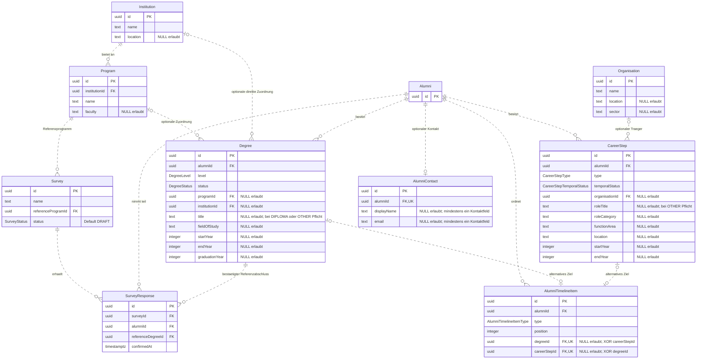

# Alumni CareerMap – implementiertes Datenmodell

**Stand: 22.10.2026.** Dieses Dokument visualisiert den aktuellen Stand von
[schema.prisma](../../prisma/schema.prisma) und den fünf
[SQL-Migrationen](../../prisma/migrations/). Fachlich maßgeblich bleibt das
[MVP Domain Model](MVP_DOMAIN_MODEL.md). Die zugehörige
[Architekturübersicht](REPOSITORY_OVERVIEW.md) beschreibt Komponenten und Abläufe.

## 1. Fachliche Struktur

Das Modell umfasst neun Kernentitäten und die optionale Entität `AlumniContact`.
Eine Installation gehört zu einem Betreiber; es gibt keine Mandantentabelle.
`Institution`, `Program` und `Organisation` sind gemeinsam verwendete Kataloge.

Ein `Alumni` ist eine pseudonymisierte Profilidentität. Akademische Phasen liegen
in `Degree`, berufliche und sonstige Phasen in `CareerStep`. Die gemeinsame
Reihenfolge steht ausschließlich in `AlumniTimelineItem`. Die konkrete
bestätigte Referenzauswahl einer Befragung liegt in `SurveyResponse`.

Eine Antwort ist kein Snapshot: Ändern sich zulässige Stationsdaten, bleiben sie
Teil desselben Profils. Eine Antwortversionierung ist nicht vorhanden.

## 2. ER-Diagramm

Das Diagramm zeigt alle zehn Tabellen und sämtliche fachlichen Skalarfelder.
`createdAt` und `updatedAt` existieren zusätzlich in **jeder** Tabelle und sind
zur besseren Lesbarkeit nur hier beschrieben: beide `TIMESTAMPTZ(3) NOT NULL`,
Initialwert `CURRENT_TIMESTAMP`. Prisma pflegt `updatedAt` über `@updatedAt`;
die Services setzen es bei Änderungen zusätzlich explizit. Es gibt keinen
Datenbanktrigger, der es bei beliebigem SQL automatisch aktualisiert.

`PK` bezeichnet den Primärschlüssel, `FK` einen Fremdschlüssel, `UK` einen
eindeutigen Einzelschlüssel. Zusammengesetzte Unique-Regeln stehen unter dem
Diagramm. Attribute mit Kommentar `NULL erlaubt` sind optional; alle anderen
sind `NOT NULL`. Sämtliche IDs sind PostgreSQL-UUIDs, Primärschlüssel erhalten
standardmäßig `gen_random_uuid()`.

Kardinalitäten: `||` genau eins, `o|` null oder eins, `o{` null bis viele.
Gestrichelte Linien kennzeichnen Beziehungen, deren Fremdschlüssel nicht Teil
des Primärschlüssels der abhängigen Tabelle sind.
Bei den beiden Timeline-Zielen ist jeweils die einzelne Beziehung optional;
zusätzlich verlangt der XOR-Check **genau eines** der Ziele passend zum Typ.
Ein Degree beziehungsweise CareerStep darf noch ohne TimelineItem existieren,
aber höchstens einmal darin vorkommen. Die zwei optionalen Katalogbeziehungen
eines Degrees dürfen nicht gleichzeitig gesetzt sein; beide dürfen fehlen.

### Zusammengesetzte Schlüssel und Ownership

| Tabelle | Schlüssel / Beziehung | Bedeutung |
| --- | --- | --- |
| `Program` | `UNIQUE(institutionId, name, faculty) NULLS NOT DISTINCT` | Dasselbe Program derselben Institution/Fakultät ist auch bei `faculty = NULL` eindeutig |
| `Degree` | `UNIQUE(alumniId, id)` | Zielschlüssel für Beziehungen, die Eigentümer und Station gemeinsam absichern |
| `CareerStep` | `UNIQUE(alumniId, id)` | Entsprechender Eigentümer-Zielschlüssel |
| `SurveyResponse` | `UNIQUE(surveyId, alumniId)` | Höchstens eine Antwort pro Profil und Befragung |
| `SurveyResponse` | FK `(alumniId, referenceDegreeId) → Degree(alumniId, id)` | Der ausgewählte Degree gehört zwingend zum Antwort-Alumni |
| `AlumniTimelineItem` | `UNIQUE(alumniId, position)` | Jede Position ist innerhalb eines Profils eindeutig |
| `AlumniTimelineItem` | FK `(alumniId, degreeId) → Degree(alumniId, id)` | Nur eigener Degree als Timeline-Ziel |
| `AlumniTimelineItem` | FK `(alumniId, careerStepId) → CareerStep(alumniId, id)` | Nur eigener CareerStep als Timeline-Ziel |

Die zusammengesetzten Timeline-FKs verwenden `MATCH SIMPLE`, damit der jeweils
inaktive NULL-Verweis zulässig ist. Die einzelnen Unique-Regeln auf `degreeId`
und `careerStepId` erlauben mehrere NULLs, aber keine doppelte Stationsreferenz.
Alle Unique-Regeln werden unmittelbar geprüft; ein Reordering darf deshalb
keine zwischenzeitlichen Kollisionen erzeugen.

Zusätzliche nicht eindeutige Indizes liegen auf `Survey.referenceProgramId`,
`Degree.programId`, `Degree.institutionId`, `CareerStep.organisationId` und
`SurveyResponse(alumniId, referenceDegreeId)`. Die übrigen FK-Zugriffe verwenden
passende bereits vorhandene PK-/Unique-Indizes.

## 3. Bedeutung der zentralen Beziehungen

### Befragung und Referenzabschluss

`Survey.referenceProgramId` legt den Studiengang der Befragung fest. Erst
`SurveyResponse.referenceDegreeId` benennt den konkreten Abschluss des
teilnehmenden Profils. Es gibt weder `Alumni.referenceDegreeId` noch
`Degree.isReference`.

Für eine gültige bestätigte Teilnahme müssen gleichzeitig gelten:

1. Der Survey ist `OPEN` und gehört zum konfigurierten Betreiberbereich.
2. Der Alumni und der konkret ausgewählte Degree existieren.
3. Der Degree gehört diesem Alumni, ist `COMPLETED` und sein `programId`
   entspricht `Survey.referenceProgramId`.
4. Die Auswahl wurde ausdrücklich bestätigt; ein einzelner passender Kandidat
   genügt dafür nicht.
5. Die Antwort wird mit serverseitig erzeugtem `confirmedAt` gespeichert.

Die DB erzwingt Existenz, Ownership und Eindeutigkeit. Survey-Status,
Program-Passung, Abschlussstatus und explizite Bestätigung werden im
[Antwort-Service](../../src/lib/survey-response-service.ts) geprüft.
`confirmedAt NOT NULL` allein beweist keine menschliche Bestätigung.

Das Modell erlaubt Antworten eines Profils auf mehrere Surveys sowie mehrere
Antworten verschiedener Surveys mit demselben Referenz-Degree. Die reguläre
Oberfläche bietet diese Profilwiederverwendung noch nicht an.

### Stationen, Kataloge und Reihenfolge

Ein Degree bezeichnet eine akademische Qualifikationsphase; er kann auch noch
laufen oder ohne Abschluss beendet worden sein. Berufsausbildung, Arbeit,
Praktikum oder Weiterbildung ohne eigenen akademischen Abschluss gehören in
`CareerStep`. Dasselbe Studium wird nicht zusätzlich als CareerStep gespeichert.
Eigenständige Arbeit und Studium dürfen parallel bestehen.

Ein Degree mit `programId` leitet seine Institution aus dem Program ab. Ohne
Program kann er direkt eine `institutionId` tragen. Unbekannte Zuordnungen
bleiben NULL. Ein CareerStep kann eine Organisation referenzieren; ein
künstlicher Datensatz „Unknown“ ist nicht erforderlich.
Namen und Orte von Institutionen und Organisationen sind keine global
eindeutigen Identitäten; gleichnamige Katalogeinträge sind zulässig.

`AlumniTimelineItem` speichert nur Typ, positive Position, Eigentümer und
Stationsverweis. Stationsdaten werden nicht kopiert. Die Reihenfolge ist eine
eigene fachliche Angabe, keine automatisch aus Jahreszahlen erzeugte Identität.
Lücken in Positionen und zeitliche Überschneidungen sind erlaubt. Ein Service
zum persistenten Reordering ist derzeit noch nicht implementiert.

### Kontaktgrenze

`Alumni` enthält ausschließlich Identität und technische Zeitpunkte. Name und
E-Mail liegen im optionalen `AlumniContact`; mindestens eines der beiden Felder
muss nichtleer sein. `email` ist nicht eindeutig und besitzt keine
Datenbankprüfung auf ein E-Mail-Format. Sie dient nicht der automatischen
Profilzusammenführung. Kontakt kann unabhängig vom Karriereprofil gelöscht
werden; eine Teilnahme benötigt keinen Kontakt.

Es gibt keine kanonischen Spalten für LinkedIn-ID, Tokens, Rohprofile,
CV-Dateiverweise oder Einwilligungs-/Importläufe. Der temporäre
[Normalisierungsvertrag](../../src/lib/normalization/contract.ts) ist ein
In-Memory-Vertrag und keine weitere persistierte Domänentabelle.

## 4. Enumerationen

| Enum | Zulässige Werte |
| --- | --- |
| `SurveyStatus` | `DRAFT`, `OPEN`, `CLOSED` |
| `DegreeLevel` | `BACHELOR`, `MASTER`, `PHD`, `DIPLOMA`, `CERTIFICATE`, `OTHER` |
| `DegreeStatus` | `IN_PROGRESS`, `COMPLETED`, `ENDED_WITHOUT_DEGREE`, `UNKNOWN` |
| `CareerStepType` | `EMPLOYMENT`, `INTERNSHIP`, `EDUCATION`, `VOCATIONAL_TRAINING`, `VOLUNTEERING`, `SELF_EMPLOYMENT`, `UNEMPLOYED`, `OTHER` |
| `CareerStepTemporalStatus` | `ONGOING`, `ENDED`, `UNKNOWN` |
| `AlumniTimelineItemType` | `DEGREE`, `CAREER_STEP` |

Die DB garantiert gültige Enumwerte und Pflichtfelder. `Survey.status` hat als
einziger fachlicher Status einen Default (`DRAFT`). Ein Statusübergangsgraph
liegt nicht als Constraint vor; der aktuelle Statusservice erlaubt alle
Übergänge zwischen den drei gültigen Survey-Statuswerten.

## 5. Integritätsregeln: Datenbank und Anwendung

Das Prisma-Schema allein bildet die Datenbankgarantien nicht vollständig ab.
Die SQL-only-Regeln sind in den versionierten Migrationen implementiert.

| Regel | Absicherung im aktuellen Stand |
| --- | --- |
| Echte Beziehungen und Ownership | PostgreSQL-FKs, einschließlich der zusammengesetzten Eigentümer-FKs |
| Degree-Katalogzuordnung | SQL-Check: `programId IS NULL OR institutionId IS NULL` |
| Timeline-Ziel | SQL-Check: `DEGREE` mit ausschließlich `degreeId` oder `CAREER_STEP` mit ausschließlich `careerStepId` |
| Timeline-Position | SQL-Check `position > 0` und Unique-Regeln für Position und Ziel |
| Bekannte Jahre | SQL-Checks: 1–9999; bei bekanntem Beginn und Ende `startYear <= endYear` |
| Degree-Zeitstatus | SQL-Check: `IN_PROGRESS` und `UNKNOWN` haben kein `endYear` |
| Abschlussjahr | SQL-Checks: nur bei `COMPLETED`; bei bekannten Werten nicht vor Beginn oder Ende; bei `COMPLETED` weiterhin optional |
| CareerStep-Zeitstatus | SQL-Check: `ONGOING` und `UNKNOWN` haben kein `endYear` |
| Texte und Bezeichnungen | SQL-Checks: Pflichttexte nichtleer, optionale Texte NULL oder nichtleer; `DIPLOMA`/`OTHER` verlangen Degree-Titel, CareerStep `OTHER` einen `roleTitle` |
| Kontakt | SQL-Checks: mindestens ein Kontaktfeld und keine ausschließlich aus Leerraum bestehende Angabe; höchstens ein Kontakt je Alumni |
| Program-Eindeutigkeit bei NULL | SQL-Index mit `NULLS NOT DISTINCT` |
| Antwort nur bei offenem Survey | Domain-Service mit Survey-Zeilensperre, keine tabellenübergreifende DB-Regel |
| Degree passt zu Survey und ist abgeschlossen | Antwort-Service; `updateDegree` schützt anschließend bestehende Antworten |
| Explizite Referenzbestätigung und Betreiberbereich | Antwort-Service mit separatem Konfigurationsinput |
| Referenzprogramm eines Surveys bleibt unverändert | MVP-Servicevertrag; kein angebotener Änderungsweg und kein DB-Trigger |
| `Program.institutionId` und Ownership bleiben unverändert | MVP-Servicevertrag; keine angebotenen Transfers |
| Trimmen, Unicode-Normalisierung, semantische Doppelstationen | Normative Service-Anforderungen; derzeit kein allgemeiner Stationsanlage-/Importschreibservice, der dies umfassend umsetzt |

Direkte SQL-Änderungen können also trotz gültiger FKs die Program-Passung,
Abschlussstatusregel oder Survey-Statusregel einer Antwort verletzen. Es gibt
bewusst keinen Trigger über Survey, Program und Degree. Anwendungsschreibwege
müssen die vorhandenen Service- und Sperrkonventionen einhalten.

## 6. Löschverhalten

Alle Fremdschlüssel verwenden bei Schlüsselupdates `ON UPDATE NO ACTION`.

| Gelöschtes Objekt | Wirkung / Schutz |
| --- | --- |
| Alumni über `deleteAlumniProfile` | Service entfernt Antworten zuerst; danach kaskadieren Degrees, CareerSteps, TimelineItems und Kontakt in derselben Transaktion |
| Alumni direkt per SQL | Owner-FKs sind `CASCADE`; ein durch eine Antwort referenzierter Degree kann wegen `RESTRICT` die Profillöschung blockieren. Deshalb ist der Serviceweg erforderlich |
| Degree | `RESTRICT`, solange eine SurveyResponse darauf verweist; sonst kaskadiert ein vorhandenes TimelineItem |
| CareerStep | Vorhandenes TimelineItem wird kaskadierend entfernt |
| TimelineItem | Station bleibt erhalten |
| Survey | `RESTRICT`, solange Antworten existieren |
| Program | `RESTRICT`, solange Survey oder Degree darauf verweisen |
| Institution | `RESTRICT`, solange Program oder Degree darauf verweisen |
| Organisation | `RESTRICT`, solange CareerStep darauf verweist |
| AlumniContact | Profil, Stationen und Antworten bleiben erhalten |
| SurveyResponse | Profil und Referenz-Degree bleiben erhalten |

Die Profillöschung ist eine interne Operation. Der Aufrufer muss die Berechtigung
separat sicherstellen; eine Alumni-UUID ist kein Zugangsnachweis. Öffentliche
Lösch- und Kontaktendpunkte existieren derzeit nicht.

## 7. Versionierte Datenbankbasis und Nachweise

| Migration | Angelegte Struktur |
| --- | --- |
| [20261008104500_phase_a_domain](../../prisma/migrations/20261008104500_phase_a_domain/migration.sql) | Institution, Program, Survey, Alumni, Degree, SurveyResponse; Enumwerte, Ownership, Katalog-, Text- und Zeitregeln |
| [20261008121500_phase_b_1_organisation](../../prisma/migrations/20261008121500_phase_b_1_organisation/migration.sql) | Organisationskatalog und nichtleere Texte |
| [20261008123300_phase_b_2_career_step](../../prisma/migrations/20261008123300_phase_b_2_career_step/migration.sql) | CareerStep mit Typen, Zeitstatus und Eigentümer-Zielschlüssel |
| [20261008124500_phase_b_3_alumni_timeline_item](../../prisma/migrations/20261008124500_phase_b_3_alumni_timeline_item/migration.sql) | Gemeinsame Timeline, XOR, positive eindeutige Positionen, Eigentümer-FKs |
| [20261008125500_phase_b_4_alumni_contact](../../prisma/migrations/20261008125500_phase_b_4_alumni_contact/migration.sql) | Separater optionaler Kontakt mit höchstens einer Zeile je Profil |

Neue Schemaänderungen benötigen versionierte Migrationen, die die vorhandenen
SQL-only-Garantien erhalten. `prisma db push` ist kein Ersatz. Im Betrieb führt
`npm run db:deploy` die Migrationen aus; `npm run db:validate` prüft nur den
Prisma-Vertrag und weist die SQL-only-Garantien nicht nach.

Die [Datenbank-Integrationstests](../../tests/integration/domain.test.ts)
prüfen Constraints direkt gegen PostgreSQL 17. Weitere Tests prüfen
[Antwortanlage](../../tests/integration/survey-response-service.test.ts),
[Referenzwechsel](../../tests/integration/reference-degree-replacement.test.ts),
[Degree-Änderungen](../../tests/integration/degree-service.test.ts),
[Profillöschung](../../tests/integration/alumni-service.test.ts) und den
[Survey-Lebenszyklus](../../tests/integration/survey-lifecycle.test.ts)
einschließlich konkurrierender Operationen. Alle Testdaten sind synthetisch.
