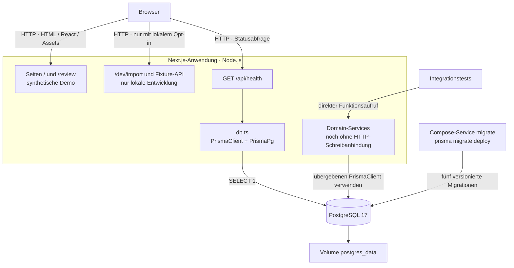
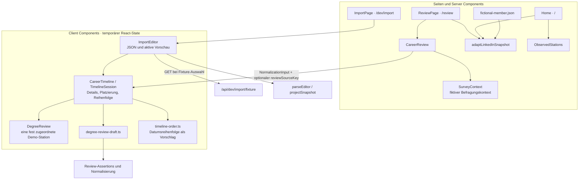
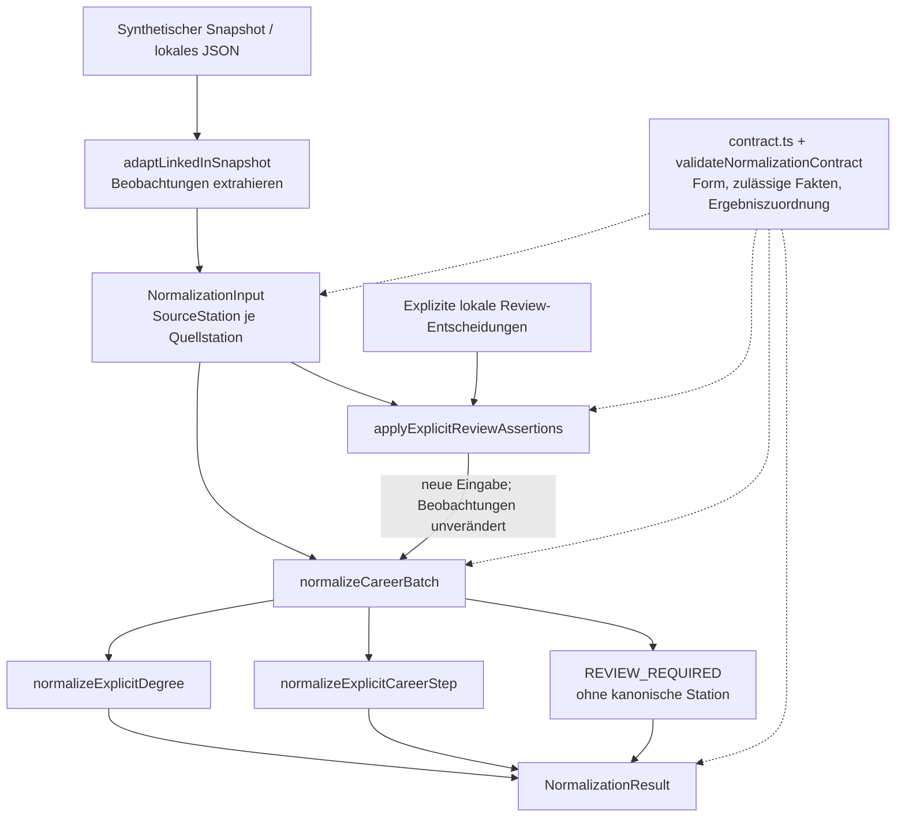
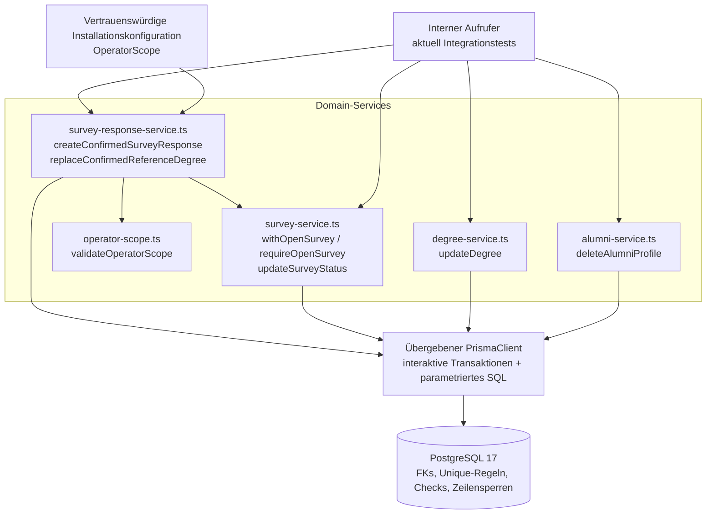

# Alumni CareerMap – Architektur des aktuellen Repositories

**Stand: 22.10.2026.** Diese Bestandsaufnahme beschreibt den lokalen Arbeitsbaum,
einschließlich der bereits vorhandenen, noch nicht committeten Review-/Import-
und Testergänzungen. Sie ist keine Spezifikation zusätzlicher Funktionen.
Das [MVP Domain Model](MVP_DOMAIN_MODEL.md) bleibt die normative Architekturquelle.
Das zugehörige [Datenmodell mit ER-Diagramm](DATA_MODEL.md) beschreibt die
implementierten Tabellen und Datenbankregeln.

## 1. Überblick und Umsetzungsstand

CareerMap ist eine selbst hostbare Next.js-Anwendung für studiengangsbezogene
Alumni-Karrierewege. Der aktuelle Stand verbindet drei unterschiedlich weit
entwickelte Bereiche:

| Bereich | Im Arbeitsbaum vorhanden | Aktuelle Grenze |
| --- | --- | --- |
| Datenhaltung | Zehn kanonische Tabellen, fünf SQL-Migrationen, PostgreSQL 17 | Keine produktiven Alumni-Daten oder automatischen Seeds Bestandteil des Repos |
| Domain-Services | Survey-Status, bestätigte Antwort, Referenzwechsel, Degree-Änderung, Profillöschung | Interne Funktionen; noch kein Datenspende-HTTP-Endpunkt und keine Anbindung der Review-UI |
| Normalisierung | Quellenneutraler Vertrag, Snapshot-Adapter, explizite Review-Assertions, Degree-/CareerStep-/Batch-Normalisierung | Reine In-Memory-Verarbeitung; kein Speichervorgang |
| Öffentliche Oberfläche | Startseite und interaktive Review-Demo mit fiktivem Snapshot | Keine echte Teilnahme; Referenzabschluss bleibt ungewählt |
| Lokaler Testimport | JSON-Editor, synthetische Fixture-Auswahl, temporäre Timeline | Nur lokale Entwicklung mit Opt-in; kein Live-Abruf und keine Persistenz |
| Betrieb und Tests | Docker Compose, Healthcheck, Vitest, PostgreSQL-Integrationstests, Playwright, GitHub Actions | Lokale Tests und Remote-CI sind getrennte Nachweise |

LinkedIn-OAuth, echter Providerabruf, CV-Verarbeitung, eine vollständige manuelle
Datenspende, Wiederaufnahme eines gespeicherten Profils, Ergebnisaggregation,
Sankey-Dashboard und E-Mail-Versand sind noch nicht implementiert. Die
[Anforderungen](../requirements/REQUIREMENTS.md) und
[UC-01](../requirements/UC-01_ALUMNI_DATA_DONATION.md) beschreiben dazu das Zielbild.

### Technischer Stack

Die Versionsangaben stammen aus `.nvmrc` und `package-lock.json`, nicht allein aus
den Versionsbereichen in `package.json`.

| Baustein | Aktueller Stand | Aufgabe |
| --- | --- | --- |
| Node.js | 22.23.3 | Lokale Entwicklung, CI und Docker-Basis |
| Next.js / React | 16.3.8 / 19.3.0 | App Router, serverseitige Seiten, interaktive Client Components |
| TypeScript | 5.9.3 | Typisierung von UI, Normalisierung und Services |
| Prisma / PostgreSQL-Adapter | 7.10.0 | Generierter Client und Zugriff über `@prisma/adapter-pg` |
| PostgreSQL | 17, Image `postgres:17-bookworm` | Einzige unterstützte Datenbank, echte FKs und SQL-Constraints |
| Vitest / Playwright | 4.1.11 / 1.64.1 | Unit-/Interaktionstests, DB-Integration und Browser-Journeys |

## 2. Komponentendiagramm: Laufzeit und Deployment

Die Anwendung wird als ein Next.js-Prozess ausgeliefert. Die Domain-Services
sind Module desselben Projekts. Der aktuell angeschlossene DB-Zugriff der
HTTP-Anwendung ist der Healthcheck; die fachlichen Schreibservices werden bisher
über Integrationstests aufgerufen.



Das Diagramm zeigt die möglichen Aufrufe der Module. Die Integrationstests
verwenden einen eigenen kurzlebigen PostgreSQL-Container und niemals das
Compose-Datenbankvolume.

In [compose.yaml](../../compose.yaml) gilt die Startreihenfolge
`db gesund → migrate erfolgreich → app`. Der Host-Port der App ist auf
`127.0.0.1:3000` gebunden; die DB veröffentlicht standardmäßig keinen Host-Port.
Der [Dockerfile](../../Dockerfile) trennt Abhängigkeiten, Migration, Build und
Runtime. Die Runtime startet als Benutzer `node` den Next.js-Standalone-Server.
`next.config.ts` setzt `output: "standalone"`.

`DATABASE_URL` wird beim ersten Healthcheck-Zugriff in
[db.ts](../../src/lib/db.ts) ausgewertet. Der Client wird pro Prozess wiederverwendet;
Verbindungsaufbau und Query haben je ein Timeout von 3 Sekunden.
[health.ts](../../src/lib/health.ts) bildet das Ergebnis auf HTTP 200 mit
`{"status":"ok"}` beziehungsweise HTTP 503 mit `{"status":"unavailable"}` ab.
Die Antwort wird nicht gecacht und enthält keine Datenbankdetails.

## 3. Komponentendiagramm: Oberfläche und lokale Entwürfe

Pfeile bezeichnen Komponentenverwendung beziehungsweise Modulabhängigkeiten.
Server Components liefern die Ausgangsdaten; die interaktive Bearbeitung liegt
in Client Components und deren lokalem React-State.



Wichtige Zustandsgrenzen:

- `proposeDisplayOrder` schlägt anhand eindeutiger Anfangsdaten eine Darstellung
  vor. Stationen mit fehlendem oder unpräzisem Beginn bleiben zunächst separat.
  Monatsangaben werden nur sortiert, soweit die gemischte Datumspräzision das zulässt.
- Erst die ausdrückliche Übernahme der vollständigen Reihenfolge liefert
  Entwurfspositionen. Verschieben oder erneutes Platzieren hebt diese Bestätigung auf.
- Die feste Degree-Prüfung wird der bekannten synthetischen Beispielstation
  zugeordnet. Eigene JSON-Eingaben erhalten keine automatisch bestimmte Prüfstation.
  Das ist noch keine allgemeine Bearbeitungsoberfläche für sämtliche Stationen.
- Review-Helfer bauen Assertions immer auf den ursprünglichen Beobachtungen auf.
  Ein Wechsel der Quelle ersetzt die Timeline-Session; alte Entscheidungen werden
  nicht auf die neue Quelle übertragen.
- Reload und Zurücksetzen verwerfen den Entwurf. Es gibt keinen Speicherrequest,
  keine lokale dauerhafte Ablage und keine bestätigte SurveyResponse.

Quellen: [CareerReview](../../src/app/review/career-review.tsx),
[CareerTimeline](../../src/app/review/career-timeline.tsx),
[DegreeReview](../../src/app/review/degree-review.tsx),
[Entwurfslogik](../../src/app/review/degree-review-draft.ts),
[Reihenfolgevorschlag](../../src/app/review/timeline-order.ts),
[ImportEditor](../../src/app/dev/import/import-editor.tsx).
Der zusätzliche Helfer [previewReview](../../src/lib/career-review/preview.ts)
ist durch Tests abgedeckt, wird von den aktuellen Seiten aber nicht verwendet.

### Routen und Entwicklungszugang

| Route | Aufgabe | Zugang / Datenquelle |
| --- | --- | --- |
| `/` | Projekt und Beispiel vorstellen | Öffentlich; Repository-Fixture |
| `/review` | Interaktive Karriere-Demo | Öffentlich; Repository-Fixture |
| `/api/health` | Datenbankverbindung prüfen | HTTP-GET; `SELECT 1` |
| `/dev/import` | JSON-Editor mit temporärer Vorschau | Nur `NODE_ENV=development`, `CAREERMAP_DEV_IMPORT=1` und erlaubter lokaler Anfrage |
| `/api/dev/import/fixture?id=fictional-member` | Erlaubte Karrierefelder einer synthetischen Fixture liefern | Derselbe Entwicklungszugang; nur die fest unterstützte Fixture-ID |

[proxy.ts](../../src/proxy.ts) prüft die beiden Importpfade vor dem React-Rendering.
Die Fixture-API prüft zusätzlich selbst über
[allowDevImport](../../src/lib/dev-import/access.ts). Erlaubt sind `localhost` und
`127.0.0.1` sowie passende Origin-/Forwarding-Angaben; unzulässige Anfragen erhalten
404. Dieser lokale Entwicklungszugang ist keine Teilnehmerauthentifizierung.
`npm run dev:import` bindet den Server auf `127.0.0.1:3100`.

Der JSON-Editor verarbeitet Eingaben ausschließlich im Browser. Nur die Auswahl
der Repository-Fixture erzeugt einen GET zum Server. Nach Prüfung enthält das
JSON ausschließlich erlaubte Karrierefelder und ein leeres `PROFILE`-Objekt.
Jede Änderung verwirft die vorherige Validierung und Vorschau. Eine Sequenznummer
verhindert, dass verspätete Fixture-Antworten neuere Eingaben überschreiben.

## 4. Komponentendiagramm: Normalisierung und Review

Die Pipeline übersetzt Quelldaten zunächst in Beobachtungen und anschließend –
soweit explizite Entscheidungen vorliegen – in kanonische Stationswerte.
Alle Funktionen arbeiten ohne Datenbank, Netzwerk oder dauerhafte Speicherung.



Durchgezogene Pfeile zeigen Datenfluss beziehungsweise Verarbeitung;
gestrichelte Pfeile zeigen Vertragsprüfung. Im Importeditor erfolgt vor der
Normalisierung zusätzlich eine Allowlist-Projektion:
`JSON parsen → Adapterprüfung → projectSnapshot → Adapter → Batch`.

Der [Vertrag](../../src/lib/normalization/contract.ts) unterscheidet
`OBSERVED`, `ASSERTED`, `MISSING` und `UNKNOWN`. Quellenkategorien und Titel sind
keine bestätigte Klassifikation: Eine Ausbildungsangabe wird nicht automatisch
zum Degree, ein Enddatum beweist keinen Abschluss und ein fehlendes Ende keine
laufende Beschäftigung. Katalogzuordnungen unterscheiden unbekannt, Kandidat und
bestätigte ID. Namen allein erzeugen keine Katalogidentität.

Pro Quellstation existiert genau ein Ergebnis: `RESOLVED_DEGREE`,
`RESOLVED_CAREER_STEP` oder `REVIEW_REQUIRED`. Auch ein aufgelöstes Ergebnis darf
noch offene optionale Angaben in `unresolved` enthalten. `RESOLVED` bedeutet
deshalb weder vollständige Daten noch Speicherfreigabe. Die Batch-Ausgabe behält
die Quellreihenfolge; die bestätigte Position ist ein eigenes Feld.

Source Keys korrelieren ausschließlich innerhalb einer Eingabe. Die Pipeline
erzeugt keine Alumni-Identität, Datenbank-IDs, Zeitstempel, Kontakte,
SurveyResponses oder Referenzauswahl. Assertions sind übergebene Behauptungen;
sie beweisen weder menschliche Bestätigung noch Berechtigung oder Katalogexistenz.

Quellen: [Adapter](../../src/lib/normalization/adapt-linkedin-snapshot.ts),
[Assertions](../../src/lib/normalization/apply-explicit-review-assertions.ts),
[Batch](../../src/lib/normalization/normalize-career-batch.ts),
[Degree](../../src/lib/normalization/normalize-explicit-degree.ts),
[CareerStep](../../src/lib/normalization/normalize-explicit-career-step.ts),
[Validierung](../../src/lib/normalization/validate.ts).

## 5. Komponentendiagramm: Domain-Services und Persistenz

Die Funktionen erhalten einen `PrismaClient` als Parameter. Es existiert noch
kein gemeinsamer Anwendungsschreibweg, der UI-Entwurf, Alumni-Anlage, sämtliche
Stationen, Timeline und Teilnahme atomar speichert. Die bestehenden Services
decken die folgenden internen Operationen ab:



| Operation | Verantwortung |
| --- | --- |
| `createConfirmedSurveyResponse` | Bestehenden Alumni und eigenen abgeschlossenen Degree für einen offenen Survey prüfen; genau eine bestätigte Antwort anlegen |
| `replaceConfirmedReferenceDegree` | Bestehende Antwort nach erneuter ausdrücklicher Bestätigung aktualisieren; Antwort-ID erhalten und `confirmedAt` erneuern |
| `updateSurveyStatus` | Statusänderung gegen Antwortschreibvorgänge serialisieren; alle Übergänge zwischen gültigen Enumwerten sind derzeit erlaubt |
| `updateDegree` | Nur erlaubte skalare Felder ändern; bestehende Referenzen hinsichtlich Ownership, Abschlussstatus und Program-Passung schützen |
| `deleteAlumniProfile` | Antworten zuerst entfernen und danach das Profil samt abhängigen Stationen, Timeline und Kontakt löschen |

Die [OperatorScope-Konfiguration](OPERATOR_SCOPE.md) beschränkt den Betreiber auf
eine Institution oder auf eine exakt bezeichnete Fakultät dieser Institution.
Sie kommt getrennt vom Antwortinput aus vertrauenswürdigem Servercode. Die
Verdrahtung mit einer Deployment-Konfiguration ist noch offen. Scope bezeichnet
organisatorische Zuständigkeit; ein Berechtigungs- oder Mandantensystem ist damit
nicht implementiert.

### Transaktionsablauf einer bestätigten Antwort

Das Sequenzdiagramm beschreibt den vorhandenen Service-Aufruf mit bereits
existierendem Alumni und Degree. Menschliche Eingaben finden davor statt.

```mermaid
sequenceDiagram
    participant Caller as Interner Aufrufer
    participant Service as createConfirmedSurveyResponse
    participant Guard as withOpenSurvey
    participant DB as PostgreSQL 17
    Caller->>Service: client, Auswahl, explizite Bestätigung, Konfiguration
    Service->>Guard: Operation für surveyId
    Guard->>DB: BEGIN · READ COMMITTED
    Guard->>DB: Survey FOR UPDATE lesen · OPEN prüfen
    Guard->>Service: tx und gesperrten Survey übergeben
    Service->>DB: Betreiber-Institution prüfen · Program FOR SHARE lesen
    Note over Service,DB: Institution/Fakultät abgleichen; ausdrückliche Auswahl prüfen
    Service->>DB: Alumni FOR UPDATE · Degree FOR UPDATE
    Note over Service,DB: Ownership, COMPLETED und Program-Passung prüfen
    Service->>DB: Vorhandene Antwort prüfen · SurveyResponse anlegen
    Service-->>Guard: Transaktionsergebnis
    Guard->>DB: COMMIT
    Guard-->>Service: Nach Commit auflösen
    Service-->>Caller: Bestätigte SurveyResponse
    Note over Caller,DB: Jeder Fehler innerhalb der Transaktion führt zum Rollback
```

Die Sperrreihenfolge für Antwortanlage und Referenzwechsel ist
`Survey → Program → Alumni → Degree`. Degree-Änderungen sperren
`Alumni → Degree`, Profillöschungen den Alumni; beide erwerben anschließend
keine Survey-Sperre. Statusänderungen sperren den Survey. Diese Konvention hält
die validierten Zustände bis zum Commit stabil. Erfolg wird erst nach Commit
zurückgegeben. Direkte SQL-Schreibwege können fachliche Regeln umgehen, die
bewusst im Service liegen; Einzelheiten stehen im [Datenmodell](DATA_MODEL.md).

Quellen: [Survey-Service](../../src/lib/survey-service.ts),
[Antwort-Service](../../src/lib/survey-response-service.ts),
[Degree-Service](../../src/lib/degree-service.ts),
[Alumni-Service](../../src/lib/alumni-service.ts),
[Operator-Scope](../../src/lib/operator-scope.ts).

## 6. Orientierung im Repository und Testabdeckung

| Pfad | Inhalt |
| --- | --- |
| `src/app/` | App-Router-Seiten, Layout, Styles und HTTP-Handler |
| `src/app/review/` | Timeline, Degree-Review, lokaler Entwurf und Interaktionstests |
| `src/app/dev/import/`, `src/lib/dev-import/`, `src/proxy.ts` | Lokaler Testimport und Zugangskontrolle |
| `src/lib/normalization/` | Reine Adapter-, Assertion-, Normalisierungs- und Validierungsfunktionen |
| `src/lib/*-service.ts`, `src/lib/operator-scope.ts` | Interne fachliche Schreibservices |
| `src/lib/db.ts`, `src/lib/health.ts` | DB-Verbindung und Healthcheck |
| `src/generated/prisma/` | Generierter, nicht versionierter Prisma-Client |
| `prisma/schema.prisma`, `prisma/migrations/` | ORM-Modell und verbindliche versionierte SQL-Implementierung |
| `src/test-fixtures/` | Synthetischer Snapshot sowie kanonische Testfälle und Erwartungen |
| `tests/integration/` | Datenbankregeln, Services, konkurrierende Schreibvorgänge und Survey-Lebenszyklus |
| `tests/e2e/`, `tests/e2e-import/` | Browser-Journeys für öffentliche Demo, Produktionssperre und Entwicklungsimport |
| `docs/architecture/`, `docs/requirements/`, `docs/testing/` | Architekturentscheidungen, Produktziel und Abnahmebeschreibungen |

`npm test` führt Unit- und Interaktionstests unter `src/` aus. Einzelne
Interaktionstests nutzen jsdom. `npm run test:integration` startet einen isolierten
PostgreSQL-17-Container, migriert die leere DB, generiert Prisma und führt
`tests/integration/` aus; danach wird der Container entfernt. Bestehende
`DATABASE_URL`-Werte und Datenbankvolumes werden dafür nicht verwendet.

`npm run test:e2e` baut die Anwendung und prüft zuerst den lokalen
Standalone-Produktionsserver auf Port 3102, anschließend den Entwicklungsimport
auf Port 3103. Beide Suites testen Desktop und einen schmalen Viewport mit
Chromium. Die Demo-/Importtests benötigen keine funktionierende Datenbank.
`npm run test:e2e:import` führt nur die Import-Suite aus.
Die [.github/workflows/ci.yml](../../.github/workflows/ci.yml) enthält Lint,
Unit-Tests, Schema-Validierung, Integration, Typecheck, Build und beide
Browser-Suites samt Artefakten.

Praktische Startanleitungen stehen in der [README](../../README.md),
die manuelle Abnahme unter [V0 Review-Demo](../testing/V0_REVIEW_DEMO_ACCEPTANCE.md)
und [V1a JSON-Testimport](../testing/V1A_JSON_IMPORT_ACCEPTANCE.md).
Diese Architekturaufnahme leitet den Implementierungsstand aus dem Code ab;
sie erklärt frühere Testergebnisse oder offene manuelle Abnahmen nicht
nachträglich für erfolgreich.
