# V3 – End-to-End-Integration

Stand: 2026-10-29. Branch `feat/v3a-survey-administration`, HEAD unverändert
`bfb1a7ba336b9e86f2f3c860d5cbb7b6aa808705`. Der vorgefundene lokale V3a-Stand
wurde erhalten und erweitert. Keine Commits, Pushes, Merges, Resets oder
produktiven Deployments. `.agents/`, `.claude/`, `.windsurf/` und
`skills-lock.json` waren bereits unversioniert und gehören nicht zu diesem Auftrag.

Aktuelle Ergänzung: [Klassifikationsvorschläge und Studiengangskatalog](V3_CLASSIFICATION_AND_CATALOG.md)
beschreibt die lokalen Vorschläge, das Hinzufügen von Studiengängen mit Fakultät
und deren zusätzliche Abnahme. Die folgenden Zahlen dokumentieren den Stand der
Journey-Vereinheitlichung; die neueren Ergebnisse stehen in der Ergänzung.

## Gemeinsame Journey für die aktuelle Abnahme

Einstieg in die bereits laufende Instanz: **<http://localhost:3100/>**.
Die bisherige Befragung bleibt unter
<http://localhost:3100/surveys/67d124b6-a74e-4a23-9e27-e0327030c6f6>
erreichbar. Zum bloßen Testen keinen neuen Starter ausführen: Dieser würde eine
weitere, frische temporäre Datenbank anlegen.

Die integrierte Startseite führt zur geschützten Befragungsverwaltung. Von dort
verläuft die Journey über die Einladung, die bewusst gewählte Quelle (LinkedIn
oder synthetisches Testprofil), denselben bestehenden Review-Editor, die beiden
ausdrücklichen Bestätigungen und den transaktionalen Commit zur Danke-Seite.
Diese bietet einen ausdrücklich als Betreiberaktion bezeichneten Link zum
geschützten Dashboard genau dieser Befragung. Der Link gewährt keine Berechtigung;
ohne Betreiberanmeldung bleiben Dashboard und Analytics-API gesperrt.

Eine Schrittanzeige begleitet die Datenspende. Der synthetische Weg hat einen
eindeutigen Ladebutton, der JSON-Entwurf liegt für die manuelle Prüfung in einem
aufklappbaren Bereich. „Datenspende verbindlich speichern“ bleibt an die vorhandenen
fachlichen Prüfungen gebunden. Ein direkter oder abgelaufener `/participate`-Link
führt zur Information derselben Befragung zurück, mit Hinweis auf die fehlende
Sitzung und darauf, eine bereits bestätigte Spende nicht nochmals abzugeben.

Nur im integrierten Entwicklungsmodus führen die bisherigen Einstiege
`/dev/import`, `/dev/mapping` und `/review` zur gemeinsamen Startseite;
`/dev/analytics` führt zur geschützten Befragungsauswahl. In ihren separaten
Startmodi funktionieren die bisherigen Demos unverändert. Lokale UI-Aufrufe über
`127.0.0.1:3111` wechseln unter Erhalt von Survey-Pfad und Query auf die konfigurierte
feste Callback-Origin. API-Aufrufe, OAuth-Callbacks und Schreibaufrufe werden
nicht umgeleitet. Host-/Origin-Prüfungen, Authentifizierung und Produktionssperren
bleiben aktiv; es werden keine Anmeldedaten über Redirects übertragen.

`npm run dev:integrated` übernimmt jetzt Host und Port aus einem gültigen festen
HTTP-Loopback-Callback in `LINKEDIN_REDIRECT_URI`, sonst `localhost:3100`.
Explizite `--host`-/`--port`-Argumente bleiben möglich. Der feste Callback enthält
weiterhin keine Survey-ID. Tests verwenden Port 3112 (optional
`CAREERMAP_INTEGRATED_E2E_PORT`) und einen eigenen Buildordner
`.next-integrated-e2e`; die V3a-Suite verwendet `.next-surveys-e2e`.
Dadurch blockieren ihre Next-Prozesse nicht den Buildordner der laufenden Abnahme.

Die laufende Instanz wurde zusätzlich mit der vorhandenen Betreiberanmeldung
geprüft: gemeinsame Startseite, bestehende Survey-ID, Einladung, aktiver
LinkedIn-Button, unveränderter registrierter Callback und Rückkehr nach OAuth-Abbruch.
Der nicht angemeldete Analytics-Aufruf liefert weiterhin 401. Dabei wurden keine
kanonischen Daten geschrieben und keine echten Provideraufrufe ausgeführt.
Ergebnis: `artifacts/v3-integrated/unified-journey-check.json`, Screenshot:
`artifacts/v3-integrated/unified-home.png` (beides ignorierte lokale Artefakte).

## Hintergrund zur Callback-Adresse bei der manuellen Abnahme

Die zuvor unter `127.0.0.1:3111` bereitgestellte Instanz verwendete weiterhin die
private Redirect-Konfiguration `http://localhost:3100/auth/linkedin/portability/callback`.
Die abweichende Origin deaktivierte den LinkedIn-Button korrekt. Die Survey-URL
`/surveys/<surveyId>/participate` war zu keinem Zeitpunkt der registrierte OAuth-Callback.
Die Statusanzeige unterscheidet jetzt fehlende Konfiguration und Origin-Abweichung
und erklärt den festen Callback-Pfad ausdrücklich.

Die laufende Instanz ist für diese Abnahme zusätzlich über `http://localhost:3100`
erreichbar. Dafür wurde ausschließlich der alte `npm run dev:import`-Webserver auf
3100 beendet und ein an Loopback gebundener lokaler Kompatibilitätszugang gestartet
(`/tmp/careermap-local-callback-alias.mjs`). Er reicht Browser-Host und Origin an
den unveränderten aktuellen Server auf 3111 weiter. Die bestehenden Host-/Origin-,
Cookie-, Betreiber- und Produktionsprüfungen bleiben aktiv. Es werden keine
Forwarded-Header als neue Vertrauensquelle eingeführt. Der integrierte Server und
seine temporäre Datenbank wurden nicht neu gestartet; auch die anderen Datenbanken
bleiben unverändert. Dies ist ausschließlich eine lokale Abnahmehilfe, kein
öffentliches Hosting oder allgemeiner Proxy-Betriebsmodus.

Für die vom Betreiber genannte Befragung:

- Einladung: <http://localhost:3100/surveys/67d124b6-a74e-4a23-9e27-e0327030c6f6>
- Fester, schon registrierter Callback: <http://localhost:3100/auth/linkedin/portability/callback>
- Danach erfolgt die sitzungsgebundene Rückkehr zu `/surveys/67d124b6-a74e-4a23-9e27-e0327030c6f6/participate`.

Beim Wechsel von `127.0.0.1` zu `localhost` über den Einladungslink neu beginnen:
Die Browser-Cookies gelten für unterschiedliche Hosts. Die Survey-ID und ihre
gespeicherten Daten bleiben unverändert. Bei einem späteren regulären Neustart
lässt sich dieselbe Origin ohne diese Abnahmehilfe direkt verwenden:

```sh
npm run dev:integrated -- --host localhost --port 3100
```

Der reguläre Starter legt wie bisher eine neue temporäre Testdatenbank an;
diesen Neustart nicht zum bloßen Wechsel der Adresse einer laufenden Abnahme verwenden.
Die Prozess-ID des zusätzlichen Zugangs steht in
`artifacts/v3-integrated/callback-entry-process.json`. Sein Beenden verändert keine
Datenbank. Für das Beenden der gesamten temporären Instanz gilt weiterhin die
separate Starter-PID in `server-process.json`.

Prüfung der laufenden Instanz: Button aktiv; OAuth-Start liefert 303 mit exakt dem
festen registrierten `redirect_uri`; ein geprüfter Abbruch kehrt zum selben Survey
zurück. Sämtliche externen Provideraufrufe waren bei dieser Prüfung blockiert;
es erfolgte keine echte LinkedIn-Anmeldung oder Datenspende. Das lokale Ergebnis
steht in `artifacts/v3-integrated/callback-check.json`. Ein zusätzlicher Routentest
sichert die Trennung von festem Callback und dynamischer Survey-Rückkehr, zwei
UI-Tests die verständliche Diagnose bei fehlender bzw. abweichender Konfiguration.

Historischer Nachweis für die vorherige Callback-Korrektur: gezielte UI-/OAuth-Routentests 15 bestanden,
`npm test` 949 bestanden und 1 bestehender optionaler Korpustest übersprungen;
Lint, Typecheck, Build und `git diff --check` bestanden. Der vollständige Unit-Lauf
fand zusätzlich einen bereits bestehenden Fehler des Entwicklungsbadges beim
Rendern ohne initialisierten Router (`usePathname()` liefert null); der Badge
verwendet dort jetzt wieder den fiktiven Standardkontext. Die weiter unten
aufgeführten aktuellen Integrations- und Browser-Ergebnisse stammen aus der danach
ausgeführten vollständigen Prüfung der gemeinsamen Journey.

Die gemeldete `unload`-Permissions-Policy-Warnung erklärt diese Deaktivierung nicht.
Im Anwendungscode gibt es keinen `unload`-Handler; die Origin-Abweichung ist über
den Status-Endpunkt und den deaktivierten Button nachgewiesen. Hintergrund zum
Browserhinweis: [Chrome: Deprecating unload](https://developer.chrome.com/docs/web-platform/deprecating-unload).

## Integrationsanalyse

| Vorhandener Teil | Ausgangszustand | Integrierter Übergang |
|---|---|---|
| V3a Survey-Verwaltung | Fachlich nutzbar, Einladung nur Vorschau | Bestehende Verwaltung erhält Link zum geschützten Survey-Dashboard; Einladung startet eine Teilnahme |
| LinkedIn DMA | OAuth, State, serverseitige Tokens, begrenzte Snapshot-Pagination vorhanden | Derselbe Handler mit separatem Cookie und Rückkehr in die aktive Survey-Teilnahme |
| Review/Normalisierung | Nutzbar im separaten Mapping-Workflow | Derselbe Editor im festgelegten Survey; Ergänzen, Entfernen und explizite Kategorien ergänzt |
| Kanonische Speicherung | Transaktionaler CareerImport-/SurveyResponse-Service vorhanden | Kurzlebige Teilnahmesitzung bindet Survey und Wiederholungsaufrufe; Bestätigung erst nach Commit |
| Analytics | Separate synthetische DB, Demoanker, vollständige Testfälle | Neuer geschützter SurveyResponse-Lesevertrag; explizite Referenz unabhängig vom Demoanker |
| Sankey | Vier-/Sieben-Stufen-Ansichten und Interaktion vorhanden | Dieselben Komponenten mit bestätigten Kohorten; V2.4-Demo bleibt separat |

Es wird keine zweite Import- oder Sankey-Implementierung eingeführt. Neue
technische Sitzungen sind ausschließlich Prozessspeicher, keine Domain-Entitäten.
Datenbankschema, die fünf versionierten Migrationen und das normative Domain Model
bleiben unverändert. Es gibt keinen Excel-/CV-Import und keine Bestandsdatenänderung.

## Architektur und Datenfluss

```mermaid
flowchart LR
  A[Betreiber: Survey DRAFT anlegen] --> B[OPEN und Einladungslink]
  B --> C[Information und freiwilliger Teilnahmestart]
  C --> D[Survey-gebundene Cookie-Sitzung]
  D --> E[Autorisierter DMA-Snapshot oder separater synthetischer Test]
  E --> F[Bestehender Mapping-Editor und Normalisierung]
  F --> G[Eigener Referenzabschluss und Beitrag ausdrücklich bestätigen]
  G --> H[saveCareerImport: eine PostgreSQL-Transaktion]
  H --> I[Alumni, Degrees, CareerSteps, Timeline, SurveyResponse]
  H --> J[Bestätigung nach Commit]
  I --> K[Betreibergeschützter Survey-Lesevertrag]
  K --> L[Bestehende Aggregation und interaktives Sankey]
```



### V3b – Survey, OAuth und Review

`POST /api/surveys/<surveyId>/donation` startet nach den Informationen eine
synthetische oder LinkedIn-Teilnahme. Der Server prüft den aktuellen OPEN-Status
und Betreiberbezug. Ein zufälliges HttpOnly-/SameSite-Lax-Cookie enthält eine
kurzlebige Fähigkeit; die Survey-ID im Einladungslink allein ist kein persönlicher
Zugang. Der Editor unter `/surveys/<surveyId>/participate` verlangt diese Sitzung.
Sein Survey ist festgelegt. GET liefert ausschließlich den aktiven Survey und
dessen Katalogkontext, niemals gespeicherte Profile oder andere Teilnahmen.

Die OAuth-Implementierung wird über optionale Routen-/Cookie-/Rückkehrparameter
wiederverwendet; ihre Standardkonfiguration bleibt für die alten Prototypen erhalten.
`/api/donation/linkedin/<action>` verwendet denselben Provider, Scope-Vertrag,
Codeaustausch, State-Prüfung und Token-Speicher. Der bestehende Callback dispatcht
an den passenden Cookie-Kontext. Der Survey wird auch vor OAuth-Aktionen nochmals
auf OPEN geprüft. Die Teilnahme verwendet ausschließlich das Third-Party-Produkt.
Ein Neustart oder Sitzungsablauf verlangt eine neue Autorisierung.

Die Teilnehmerseite wird nach dem Start vollständig navigiert, damit ihre
`same-origin`-Referrer-Policy für das native OAuth-Formular gilt. Der Browser hatte
unter `no-referrer` Origin `null` gesendet; dies wurde im RED-Browserlauf entdeckt.
Die Origin-Prüfung wurde nicht gelockert. Externe Navigation erhält weiterhin
keinen Referrer. Schreibaufrufe benötigen passende Origin und begrenzte JSON-Bodies.

Der bestehende Editor zeigt alle EDUCATION-/POSITIONS-Stationen. Titel, Anbieter,
Zeiten, Typ, Status, Katalog und Timeline-Position bleiben prüfbar. Stationen können
ergänzt und entfernt werden; Referenz- und Beitragsbestätigungen werden bei
Änderungen verworfen. Fachrichtung/Funktionsbereich, Jobkategorie und Branche
werden ausschließlich ausdrücklich angegeben. Diese Ergänzungen erfolgen an der
vorhandenen Importgrenze; der Normalisierungskern und seine Quellverträge bleiben
erhalten. Eine Branche wird nur beim expliziten Erzeugen einer neuen Organisation
gespeichert, kein gemeinsam genutzter Arbeitgeber wird stillschweigend geändert.

### V3c – Bestätigung und kanonische Speicherung

`saveCareerImport` bleibt der einzige Schreibdienst für den gesamten Beitrag.
Er validiert erneut Quelle, Zuordnungen, beide ausdrücklichen Bestätigungen,
Referenzstatus COMPLETED und Program-Passung. Unter dem vorhandenen Survey-Lock
werden Betreiberzuordnung und OPEN atomar geprüft. Profil, sämtliche Stationen,
TimelineItems und genau eine bestätigte SurveyResponse committen gemeinsam.
DRAFT/CLOSED, falsche Referenzen oder Fehler hinterlassen keine Teilantwort.

Die neue Teilnahmesitzung behält nur einen Payload-Hash, das laufende Promise und
den Speicherbeleg, keine Quelldaten. Gleichzeitige und spätere identische Retries
innerhalb derselben Sitzung verwenden dasselbe Promise/Ergebnis. Geänderte
Nutzlasten unter derselben Teilnahme werden abgewiesen. Auch Reload zeigt nach
Commit die Bestätigung erneut, ohne einen neuen Import auszuführen. Maximal 200
Sitzungen, 30 Minuten Gültigkeit; abgelaufene Einträge werden beim Zugriff/Anlegen
bereinigt. Tokens werden nach erfolgreichem Speichern serverseitig entfernt.

Die teilnehmende Person erhält nur Stationsanzahlen und die Bestätigung, keine
Alumni-/Response-IDs und keinen Link zu gespeicherten individuellen Profilen.
AlumniContact bleibt unberührt. Es gibt keine automatische Referenzbestätigung,
keine globale Personenidentifikation und keine Zusammenführung nach LinkedIn-ID.

### V3d – SurveyResponse, Analytics und Sankey

`readSurveyAnalytics` liest in einer Repeatable-Read-Transaktion ausschließlich
`SurveyResponse.surveyId = <ausgewählter Survey>`. Die Berechtigung wird über die
bestehende Betreiber-/Program-Prüfung kontrolliert. Die tatsächliche Referenz ist
`SurveyResponse.referenceDegreeId`, niemals ein Namensvergleich oder Demoanker.
Ownership, COMPLETED und Program-Passung werden erneut geprüft; inkonsistente
Referenzen werden mit `INVALID_REFERENCE` ausgeschlossen. Fehlende Timeline-Ziele
und unvollständige kanonische Timelines werden diagnostiziert.

Der allowlist-basierte DTO enthält Stationstyp, Status, Reihenfolge, Jahreswerte,
Fachrichtung/Funktionsbereich, Jobkategorie und Organisationsbranche. Alle
kanonischen Stationen werden gelesen; ungeklärte und parallele Phasen bleiben
enthalten. Kontakt, Providerkennungen, Rohprofile, Freitexttitel, Organisationsnamen
und Orte werden nicht in den Analytics-DTO übernommen. Interne Stations- und
Referenzkennungen dienen nur der korrekten Projektion; Profilkennungen im Dashboard
sind pseudonyme Antwortkennungen. Dieser DTO bleibt strikt betreibergeschützt.

Die Referenzauflösung ist von der Aggregation getrennt. `referenceStations` nutzt
bei Survey-Daten ausschließlich die explizite Referenz; bei bestehenden Demo-Daten
weiterhin deren Demoanker. Es werden keine Demoanker zu SurveyResponses umgewandelt.
`completeTestCase` ist für Survey-Kohorten immer false, auch bei synthetischen
Spenden: Das kanonische Modell enthält keine Vollständigkeitsdeklaration.
Fehlende Master-/Berufsphasen bedeuten deshalb unbekannt. Die Filter „mit/ohne
Master“ schließen unbekannte Präsenz aus und zeigen dies an.

Die MSI-Projektion wird durch die explizite vertrauenswürdige
`CAREERMAP_MSI_PROGRAM_ID` begrenzt; zusätzlich ist ein bestätigter Bachelor nötig.
Andere Programme erhalten eine neutrale Meldung statt falscher MSI-Bezeichnungen;
andere Referenzlevel werden als `UNSUPPORTED_PROJECTION` ausgeschlossen.
Dies ist keine neue Survey-Level-Eigenschaft: Nach Domain Model darf ein passender
COMPLETED-Degree auch ein anderes Level besitzen. Diese Antworten bleiben gültig,
können jedoch nicht in die fachlich nur für den MSI-Bachelor definierte Projektion
aufgenommen werden. Unbekannte Ankerzeiten sind zulässig beim Spenden, führen in
der jahresabhängigen Projektion jedoch zu einem sichtbaren Ausschluss.

Vier-Stufen-Standard, Sieben-Stufen-Historie, Masterfilter, Darstellungsfokus,
Sortierung, Prozentwerte, Hover/Fixierung, Tastaturbedienung und Tabellenalternative
verwenden die bestehenden Komponenten. Branche und Jobkategorie kommen weiterhin
aus derselben eindeutig ausgewählten ersten CareerStep-ID. Jede Person liefert
eine Einheit je benachbarter Stufengrenze: drei bzw. sechs Beiträge. Mehrere Master,
parallele Arbeit, Datumsgrenzen und mehrdeutige erste Stellen behalten die bisherigen
Unklarheitsregeln. Der Darstellungsfokus verändert niemals die Kohorte.

## Offizielle LinkedIn-Prüfung und Live-Grenze

Am 2026-10-29 geprüft:

- [Third-Party-Produkt](https://learn.microsoft.com/en-us/linkedin/dma/member-data-portability/member-data-portability-3rd-party/): App-Freigabe und freiwillige Autorisierung mit `r_dma_portability_3rd_party` erforderlich.
- [Authorization Code Flow](https://learn.microsoft.com/en-us/linkedin/shared/authentication/authorization-code-flow): registrierte Redirect-URL und serverseitiger Codeaustausch; Client Secret bleibt auf dem Server.
- [Snapshot API](https://learn.microsoft.com/en-us/linkedin/dma/member-data-portability/shared/member-snapshot-api): `memberSnapshotData`, Version `202312`, Paging mit Seitenindex und unzuverlässigem `total`.

Der bestehende Provider liest ausschließlich EDUCATION/POSITIONS, begrenzt
Antwortgröße, Seiten, Zeilen und Laufzeit und akzeptiert nur sichere Folgeseiten.
Nicht verfügbare Snapshots bleiben als ausstehend erkennbar (202), Scope-/Tokenfehler
werden kontrolliert angezeigt. Es gibt weder Scraping noch einen automatischen
synthetischen Ersatz im echten Providerweg. Die synthetische Quelle wird vorab
separat gewählt und ist nur mit dem expliziten Test-Flag verfügbar.

Die lokale private Konfiguration wurde ausschließlich auf Vorhandensein und
Vertragsgleichheit geprüft: Client-ID/Secret vorhanden, Third-Party-Modus und
Scope passend, Callback-Pfad passend. Die konfigurierte Origin passt zur
gemeinsamen Adresse `http://localhost:3100`. Es wurden keine Geheimnisse ausgegeben,
keine App-Freigabe behauptet und kein echter LinkedIn-Liveabruf ausgeführt.
Für einen freiwilligen Live-Test muss die vorhandene genehmigte Redirect-URL exakt
zur Browseradresse passen; gegebenenfalls den Starter mit `--host localhost`
und dem registrierten lokalen `--port` starten. Öffentliches Hosting/Tunneln ist
nicht freigeschaltet. Der Testmock wird ausschließlich durch die separate
Browser-Testkonfiguration aktiviert und blockiert externe Netzaufrufe.

## Ausgeführte Tests

RED-Läufe: neue Referenz-/Sitzungstests, Kategoriengrenze und Survey-Analytics-Test
scheiterten vor ihrer Implementierung. Der zusätzliche sequenzielle Retry-Test
fand eine erneute Speicherung nach beendetem Promise; die Sitzung behält jetzt
auch den fertigen Beleg bis zum Ablauf. Browser-RED fand außerdem den Origin-Verlust
beim OAuth-Formular. Keine bestehenden Tests wurden abgeschwächt oder neu übersprungen.

Für die Vereinheitlichung wurden zunächst zusätzliche Tests für lokale
Startadressen, UI-Redirects, die gemeinsame Startseite, fehlende Teilnahmesitzungen
und den Abschlusslink geschrieben und rot ausgeführt. Danach folgten Umsetzung
und die unten dokumentierten vollständigen Regressionen. Die integrierte
Browser-Suite startet jetzt auf der gemeinsamen Startseite und prüft auch die
Weiterleitung alter Einstiege. Ein erster Gesamtlauf stieß beim Start der
V3a-Suite auf den vom manuellen Server belegten Next-Buildordner; nach Trennung
der Test-Buildordner lief die gesamte Kette erfolgreich. Der manuelle Server und
seine Datenbank wurden dafür nicht beendet.

| Befehl | Ergebnis |
|---|---|
| `npx vitest run src/lib/donation/sessions.test.ts src/lib/analytics/reference.test.ts src/lib/dev-import/linkedin/routes.test.ts` | 14 bestanden |
| `npx vitest run src/lib/career-import/review-details.test.ts src/lib/career-import/mapping.test.ts` | 8 bestanden |
| `npx vitest run src/lib/donation src/lib/analytics/reference.test.ts src/lib/career-import/review-details.test.ts` | 5 bestanden |
| `npm run lint` | bestanden, keine Warnungen |
| `npm test` | 956 bestanden; 1 bestehender optionaler lokaler Korpustest übersprungen |
| `npm run db:validate` | bestanden |
| `npm run test:integration` | 375 bestanden; 1 bestehender optionaler lokaler Korpustest übersprungen |
| `npm run typecheck` | bestanden |
| `npm run build` | bestanden |
| `npm run test:e2e:integrated` | 6 bestanden: Desktop und Tablet, je synthetische Gesamtkette, simulierter autorisierter OAuth-Weg und gemeinsame Einstiege |
| `npm run test:e2e` | gesamte Kette einschließlich erneutem Build: 71 bestanden |
| davon Review/Produktionsschutz / Import / OAuth | 6 / 30 / 8 bestanden |
| davon Mapping / Workflow / V2.4-Analytics / V3a / integrierter Workflow | 6 / 2 / 9 / 4 / 6 bestanden |
| `git diff --check` | bestanden |

Die zwei optionalen Korpustests werden ausdrücklich nicht als Erfolg gezählt.
Die V2.4-Browserdemo wurde mit dem bisherigen isolierten synthetischen CI-Korpus
geprüft; die zusätzliche lokale 100er-Browserabnahme und `analytics:compare`
wurden nicht erneut ausgeführt. Die unveränderten Mapping-Regressionen können
vorhandene lokale synthetische Phase-D-Dateien für ihre optionale Fixture-Liste
lesen und auditieren; der neue integrierte Weg verwendet diese Dateien nicht.
Die vollständige Browserkette schreibt ihr lokales Laufprotokoll nach
`/tmp/v3-unified-journey-browser.log`, der aktuelle Integrationstest nach
`/tmp/v3-unified-journey-integration.log`. Der Integrationstest meldet zusätzlich
eine bestehende pg-Warnung zu gleichzeitigem `client.query()`; der Lauf ist grün.
Die CI erhält die integrierte Suite und ihre
Reports zusätzlich zu allen bestehenden Suites; keine Remote-CI wurde gestartet.
Sandbox-Blockaden für Docker/Serverports wurden mit Ausführungsfreigabe wiederholt.
Ein gesonderter Screenreader-Praxistest bleibt offen.

### Entscheidender End-to-End-Nachweis

`tests/e2e-integrated/workflow.spec.ts` öffnet die gemeinsame Startseite und
erstellt über deren Verwaltungslink zwei neue
geöffnete MSI-Surveys. Drei voneinander getrennte Browserkontexte spenden passende
LinkedIn-kompatible synthetische Profile (Bachelor, Master und Tätigkeit).
Ergänzen/Entfernen einer Station und fehlende Bestätigungen werden geprüft;
Referenz und Beitrag werden danach ausdrücklich bestätigt. Reload bleibt auf der
Bestätigung und erzeugt keinen neuen Beitrag. Der geschützte Leseweg liefert
exakt zwei Antworten für Survey A und eine für Survey B. Sankey und Masterfilter
zeigen für A zwei Personen und sechs bzw. zwölf Übergangsbeiträge; Sortierung,
Fokus und Tastaturfixierung werden betätigt. Kein Datenbankeingriff verbindet die
Schritte. Ein separater Test prüft den autorisierten, komplett simulierten
Providerweg einschließlich Abbruch, erneutem OAuth, Snapshot-Abruf, Bearbeitung,
Bestätigung und kanonischer Speicherung von vier Stationen. Der Abschlusslink
zeigt auf genau das geschützte Dashboard der aktiven Befragung. Providerfehler,
Pagination, ungültiger State und Scope-/Snapshot-Verfügbarkeit sind zusätzlich
über die unverändert ausgeführten vorhandenen Provider-/Routentests abgedeckt.

## Lokale manuelle Abnahme

Voraussetzungen: Node 22.23.3 gemäß `.nvmrc`, installierte Pakete, Docker für PG17.
Eine private `CAREERMAP_SURVEY_ADMIN_TOKEN` mit mindestens 32 Zeichen in der
ignorierten `.env.local` oder Prozessumgebung konfigurieren. Dann:

```sh
npm run dev:integrated
```

Startet ausschließlich eine frische kurzlebige PG17-Testdatenbank mit den
bestehenden Migrationen, einem synthetischen Betreiber und dem expliziten
MSI-Pilotprogramm. Vorhandene Datenbank-URLs und persistente Volumes werden nicht
benutzt. Die Adresse folgt der lokalen Callback-Konfiguration; ohne diese gilt
`http://localhost:3100`. Daten bleiben bis zum Beenden des Starters erhalten; Strg+C entfernt den
Testcontainer. Sitzungen und Retry-Belege liegen nur im Serverprozess.
Die bisherigen Befehle `dev:surveys`, `dev:workflow` und `analytics -- dev` bleiben
für ihre separaten Prototypen erhalten. Die automatisierten integrierten und
V3a-Browser-Suites verwenden nun eigene Buildordner; die integrierte Suite auch
einen separaten Port. Zwei manuelle integrierte Starter teilen dagegen weiterhin
denselben manuellen Buildordner und dürfen nicht gleichzeitig gestartet werden.

1. <http://localhost:3100/> öffnen und „Befragungen verwalten“ wählen. Basic-Benutzer `operator`, privates
   lokales Testpasswort verwenden. Hochschule und MSI-Programm wählen, Survey
   anlegen und öffnen. Der Studiengang ist danach unveränderlich.
2. Den dort kopierten `/surveys/<surveyId>`-Link in einer separaten privaten
   Browsersitzung öffnen. Informationen lesen und ausdrücklich den synthetischen
   Testweg starten. „Synthetisches Testprofil laden“ lädt den neuen,
   ausschließlich fiktiven Bachelor-/Master-/Tätigkeitsfall.
3. Stationen prüfen, bei Bedarf ergänzen, entfernen und korrigieren. Referenz ist
   zunächst leer. Den eigenen synthetischen Bachelor auswählen und beide
   Bestätigungen setzen. „Datenspende verbindlich speichern“ führt nach Commit zur
   Danke-Seite. Neuladen darf keinen weiteren Beitrag erzeugen.
4. Als angemeldeter Betreiber auf der Danke-Seite „Geschützte Auswertung öffnen“
   oder in der Verwaltung „Bestätigte Antworten auswerten“ wählen. Unter
   `/admin/surveys/<surveyId>/analytics` Vier-/Sieben-Stufen-Ansicht, Masterfilter,
   Fokus, Sortierung, Hover, Klick/Enter-Fixierung und Escape prüfen. Die
   Häufigkeitstabelle ist die vollständige Textalternative.
5. Mit einer weiteren privaten Sitzung einen zweiten synthetischen Beitrag
   speichern. Einen zweiten Survey anlegen und dort getrennt spenden. Nur die
   Antworten des jeweils ausgewählten Surveys dürfen erscheinen.
6. Survey schließen: Neue Starts und Speicherungen werden abgewiesen. Nach
   Wiederöffnen ist Teilnahme wieder möglich. Ohne Betreiberanmeldung müssen
   Dashboard und Analytics-API unzugänglich bleiben.

Für diese Arbeitsrunde läuft weiterhin dieselbe Abnahmeinstanz auf Port 3111,
erreichbar über den oben erläuterten Loopback-Zugang unter `localhost:3100`.
Das zufällige Passwort liegt lokal mit Dateimodus 0600 in
`artifacts/v3-integrated/admin-access.json` (ignoriert, nicht im Repository).
Die über die Oberfläche angelegte Befragung „V3 · Manuelle Abnahme“ besitzt einen
bestätigten synthetischen Beitrag; ihre konkreten Einladungs-/Dashboard-URLs liegen
in `artifacts/v3-integrated/demo-context.json`. Ihre Einladung: <http://localhost:3100/surveys/ebcb490c-9ff7-4373-9ec2-713e565522a5>; geschütztes Dashboard: <http://localhost:3100/admin/surveys/ebcb490c-9ff7-4373-9ec2-713e565522a5/analytics>. Zusätzlich bleibt die vom Betreiber angelegte Befragung mit ID `67d124b6-a74e-4a23-9e27-e0327030c6f6` erhalten. Diese Links gelten nur für die laufende Testinstanz. Der Live-Sanity-Check liest die drei
kanonischen Stationen samt Fachrichtung, Branche und Jobkategorie über den
geschützten Leseweg zurück. Screenshots liegen unter `artifacts/v3-integrated/`.
Zum gezielten Beenden dieser bereitgestellten Instanz die PID in
`artifacts/v3-integrated/server-process.json` verwenden und SIGTERM an den dort
aufgeführten Starter senden; dieser entfernt auch seinen temporären DB-Container.

## Wiederverwendung, neue Dateien und Grenzen

Wiederverwendet/erweitert: V3a-Verwaltung und Zugriffsgates; `MappingEditor`,
`useLinkedInImport`, CareerImport-Mapping/-Service; LinkedIn-Handler und Callback;
Analytics-Records/-Aggregation/-Overview; Dashboard und Sankey. Der Entwicklungsbadge
unterscheidet echte Survey-Kontexte von den unveränderten fiktiven Demo-Seiten.

Neu: `src/lib/donation/{sessions,routes,synthetic,linkedin}.ts`, deren Tests,
`src/lib/surveys/analytics.ts`, expliziter Referenztest, Kategorienreview-Test,
Survey-Analytics-Integrationstest, Teilnehmerstart/-seite, Donation-API-Routen,
geschützte Survey-Analytics-Seite/-API, `environment-label.tsx`,
`playwright.integrated.config.ts` und `tests/e2e-integrated/workflow.spec.ts`.
Für die gemeinsame Journey zusätzlich: `src/app/journey-home.tsx`,
`src/lib/donation/entry-config.ts`, `src/app/surveys/donation-steps.tsx` sowie
Startseiten-, Routing-, Sitzungsrückkehr- und Abschlusslink-Tests. Geändert sind
außerdem `page.tsx`, Layout/Badge, `proxy.ts`, Einladung/Teilnehmerseite,
Mapping-Editor, Betreiberseite und die Testkonfigurationen für getrennte Ports
und Buildordner. Die konkreten neuen UI-Bezeichnungen gelten nur für den
integrierten Teilnehmerkontext; separate Mapping-/Import-Demos bleiben erhalten.
Startskript, npm-Befehle, Produktionsschutztest, CI, Ignorierregeln und
`.env.example` sind entsprechend ergänzt. Die komplette vorhandene V3a-Arbeit
ist weiterhin uncommittet enthalten. Keine persönlichen Quelldateien wurden übernommen.

Es gibt keinen normativen Architekturkonflikt im implementierten Umfang. Offen
bleiben die fachliche Projektion anderer Programme/Abschlusslevel, eine
Vollständigkeitsdeklaration, Produktionsauthentifizierung und persistente,
mehrinstanzfähige Sitzungs-/Retry-Verwaltung. Nach Sitzungsablauf oder Prozessverlust
existiert keine dauerhafte Personen-/Importidentität; absichtliche erneute Teilnahme
mit einer neuen Sitzung kann nicht global erkannt werden. Dies darf nicht durch
LinkedIn-IDs, Kontaktabgleich oder versteckte Domain-Erweiterungen ersetzt werden.

Vor Produktivbetrieb bleiben Verarbeitungszwecke, Rechtsgrundlagen, Einwilligung,
Aufbewahrung, Berichtigung/Löschung ohne Kontakt, Betreiberrollen, Auditierung,
Veröffentlichungsschwellen und Schutz kleiner Gruppen zu entscheiden. HTTP Basic
über Loopback ist nur Prototypenschutz. Kein öffentlicher Profil- oder
Ergebniszugriff, keine Freigabe kleiner Gruppen, kein öffentlicher Proxy-/Tunnelbetrieb.
Produktionssperren bleiben aktiv, auch bei versehentlich gesetzten Entwicklungsflags.
